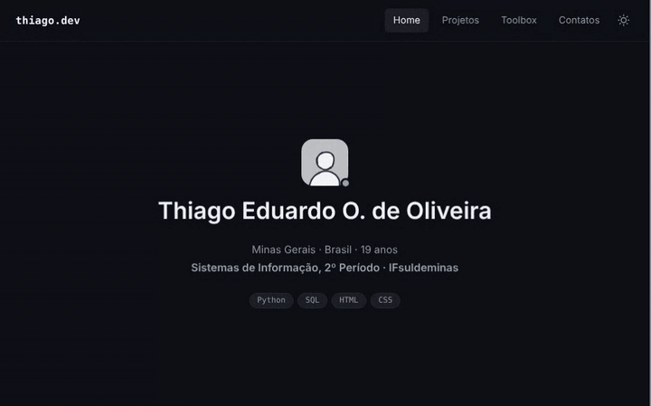
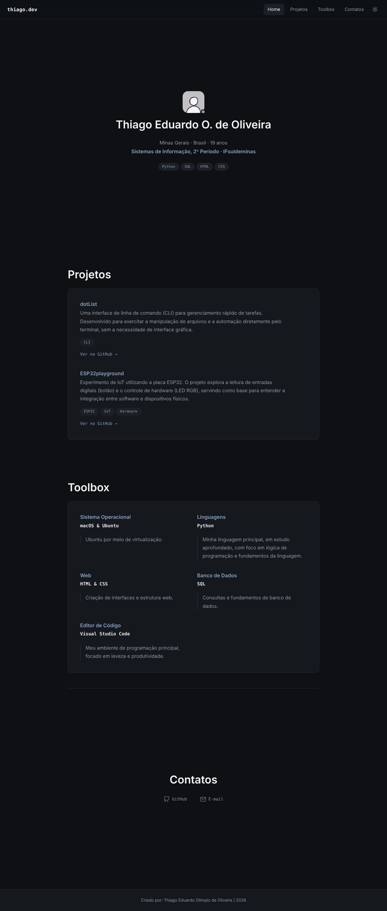
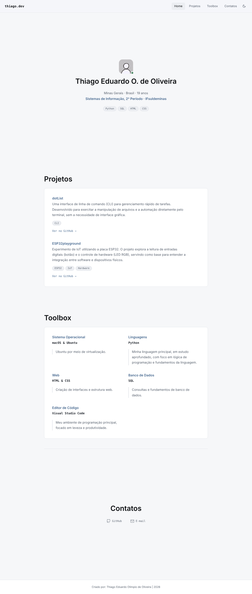
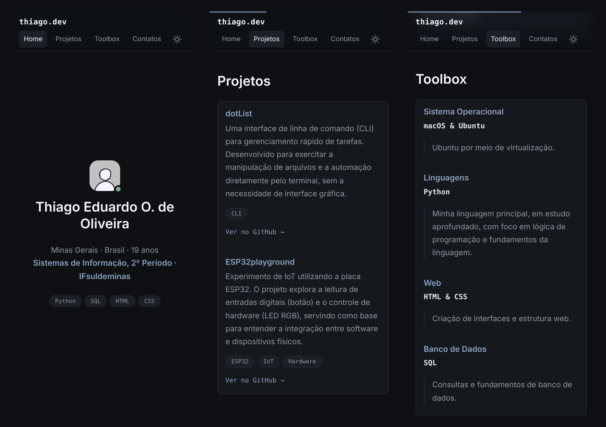
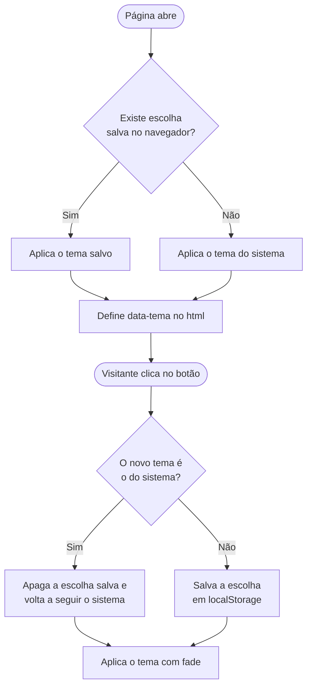

# thiago.dev

Portfólio pessoal em página única, feito com **HTML, CSS e JavaScript puros**: sem frameworks, sem dependências e sem etapa de build.

<p align="center">
  
</p>

## Sumário

- [Objetivo](#objetivo)
- [Pré-visualização](#pré-visualização)
- [Recursos](#recursos)
- [Como funciona](#como-funciona)
- [Estrutura de arquivos](#estrutura-de-arquivos)
- [Tecnologias](#tecnologias)
- [Como executar](#como-executar)
- [Personalização](#personalização)
- [Workflow do projeto](#workflow-do-projeto)
- [IA usada no desenvolvimento](#ia-usada-no-desenvolvimento)
- [Autor](#autor)

## Objetivo

Reunir em um único lugar a apresentação, os projetos, as ferramentas de trabalho e os contatos, com carregamento rápido (nenhuma biblioteca externa), boa leitura em qualquer tamanho de tela e tema claro e escuro.

O código é organizado em seções numeradas e comentadas, tanto no CSS quanto no JavaScript, para facilitar a manutenção.

## Pré-visualização

| Tema escuro | Tema claro |
| :---: | :---: |
|  |  |

No celular, o layout se adapta e o menu passa a ficar empilhado abaixo da marca:



## Recursos

**Conteúdo**
- Quatro seções: **Home**, **Projetos**, **Toolbox** e **Contatos**, com menu fixo no topo.
- Projetos em cartões com descrição, etiquetas (chips) das tecnologias e link para o repositório no GitHub.
- Toolbox organizada em grade, que se reorganiza sozinha conforme a largura da tela.
- Ano do rodapé atualizado automaticamente.

**Tema claro e escuro**
- Segue o tema do sistema, inclusive quando ele muda com a página aberta (por exemplo, o modo escuro automático ao anoitecer).
- Botão no menu para alternar o tema; a escolha fica salva no navegador.
- Cor da aba e da barra do navegador (`theme-color`) acompanha o tema ativo.
- Troca de tema com transição suave de cores.

**Animações e navegação**
- Elementos de cada seção entram com fade e subida suave ao rolar, um depois do outro.
- Barra de progresso de 2 px no topo, que mostra quanto da página já foi rolada.
- O link do menu da seção que está na tela fica destacado.
- Rolagem suave ao clicar no menu e barra de rolagem personalizada.
- Cabeçalho com efeito de vidro (desfoque do fundo).

**Acessibilidade**
- HTML semântico (`header`, `nav`, `main`, `section`, `article`, `footer`) e ícones decorativos escondidos de leitores de tela.
- Contorno visível no foco do teclado.
- Respeita a preferência "reduzir movimento": sem animação de entrada e sem transições.
- Links externos com `rel="noopener noreferrer"`.

**Robustez**
- Sem JavaScript, o conteúdo continua visível (o botão de tema só aparece quando o script liga).
- Navegadores sem `light-dark()` ou sem `backdrop-filter` recebem versões alternativas das cores e do cabeçalho.
- Nenhuma fonte, biblioteca ou script externo: tudo é carregado dos próprios arquivos do projeto.

## Como funciona

O site é estático e tem três arquivos principais.

| Arquivo | Papel |
| --- | --- |
| `index.html` | Estrutura e conteúdo. Cada seção principal é um `<section>` direto dentro de `<main>`, com os ids `#perfil`, `#projetos`, `#toolbox` e `#contatos`. |
| `style.css` | Aparência. As cores dos dois temas ficam em variáveis CSS escritas com `light-dark(claro, escuro)`, então o restante do CSS só usa `var(--nome)`. |
| `scripts.js` | Comportamento. Roda depois do HTML (atributo `defer` na tag `<script>`) e liga cada recurso por uma função própria. |

**Rotinas do `scripts.js`**

| Função | O que faz |
| --- | --- |
| `iniciarTema()` | Decide o tema, aplica no `<html>` (atributo `data-tema`) e liga o botão do menu. |
| `atualizarCorDaAba()` | Lê a cor de fundo real da página e grava na meta `theme-color`. |
| `iniciarEntradaSuave()` | Marca os elementos das seções com `.revelar` e usa `IntersectionObserver` para animar cada um quando entra na tela. Ao terminar a animação, remove as classes. |
| `iniciarProgresso()` | Cria a barra de progresso e a atualiza no máximo uma vez por quadro, com `requestAnimationFrame`. |
| `iniciarMenuAtivo()` | Marca com `aria-current="true"` o link da seção que cruza o meio da tela. |
| `atualizarAno()` | Escreve o ano atual no rodapé. |

**Como o tema é escolhido**



**Animação de entrada**

O script percorre os filhos diretos de cada `main > section`, escreve a posição de cada um na variável `--i` e adiciona a classe `.revelar` (invisível e deslocado). Quando o elemento entra na tela, recebe `.visivel` e o CSS faz a transição de opacidade e posição, com um pequeno atraso proporcional a `--i`. Depois que termina, as classes são removidas e o elemento volta ao estado normal.

## Estrutura de arquivos

```text
portifolio_dev_TDI/
├── index.html           # estrutura e conteúdo das quatro seções
├── style.css            # variáveis, temas, componentes e responsivo
├── scripts.js           # tema, animações, barra de progresso e menu ativo
├── images/
│   ├── icon/
│   │   └── perfilindex.jpg      # foto de perfil
│   └── readme/                  # imagens e GIF usados neste README
│       ├── demo.gif
│       ├── desktop-escuro.png
│       ├── desktop-claro.png
│       └── mobile.png
├── Readme.md
└── .gitignore
```

O `style.css` é dividido em seções numeradas, listadas no índice no topo do arquivo: variáveis, reset, tipografia, cabeçalho, seções, componentes, perfil, projetos, toolbox, contatos, rodapé, acessibilidade, efeitos, responsivo e reserva para navegadores antigos. O `scripts.js` segue o mesmo padrão.

## Tecnologias

| Área | O que é usado |
| --- | --- |
| Estrutura | HTML5 semântico |
| Estilo | CSS3: variáveis (custom properties), `light-dark()`, flexbox, grid, `clamp()`, `backdrop-filter` e media queries (`768px` e `520px`) |
| Comportamento | JavaScript (ES6+): `IntersectionObserver`, `matchMedia`, `localStorage`, `requestAnimationFrame` |
| Versionamento | Git e GitHub |
| Hospedagem | Netlify |

## Como executar

**Requisitos:** apenas um navegador atual. Não é preciso instalar Node, npm nem rodar build.

**1. Baixe o projeto**

```bash
git clone https://github.com/thiagoeduardoolimpio/portifolio_dev_TDI.git
cd portifolio_dev_TDI
```

**2. Abra o site** de uma das formas abaixo.

- Direto no navegador: abra o arquivo `index.html` (no macOS: `open index.html`).
- Com um servidor local, que se parece mais com o site publicado:

  ```bash
  python3 -m http.server 8000
  ```

  Depois acesse `http://localhost:8000`.

**Compatibilidade:** as cores usam `light-dark()`, que funciona no Chrome 123+, Safari 17.5+ e Firefox 120+. Em versões anteriores, o site usa um bloco alternativo no próprio CSS, com as mesmas cores.

## Personalização

| O que mudar | Onde |
| --- | --- |
| Textos, projetos e contatos | `index.html`, nas seções marcadas com comentários |
| Cores dos temas | `style.css`, seção 1, em `light-dark(claro, escuro)` |
| Foto de perfil | `images/icon/perfilindex.jpg` (ou ajuste o `src` da imagem no `index.html`) |
| Espaçamentos e larguras | Variáveis `--space1` a `--space4` e `--maxwidth`, no `style.css` |
| Animação de entrada | Classe `.revelar`, na seção 13 do `style.css` |

Ao mudar uma cor do tema, atualize também:

1. o bloco de emergência logo abaixo das variáveis, na seção 1 do `style.css`;
2. as duas metas `theme-color` no `<head>` do `index.html`, que valem até o script carregar.

## Workflow do projeto

| Branch | Uso |
| --- | --- |
| `main` | Branch principal |
| `update` | Pequenos testes. Vai direto para o Netlify |

## IA usada no desenvolvimento

- **codegemma:latest** (offline): revisão e refatoração de código.
- **Sonnet 5.5** (Claude): refatoração avançada e revisão geral do código.

## Autor

Criado por [thiagoeduardoolimpio](https://github.com/thiagoeduardoolimpio) (GitHub).